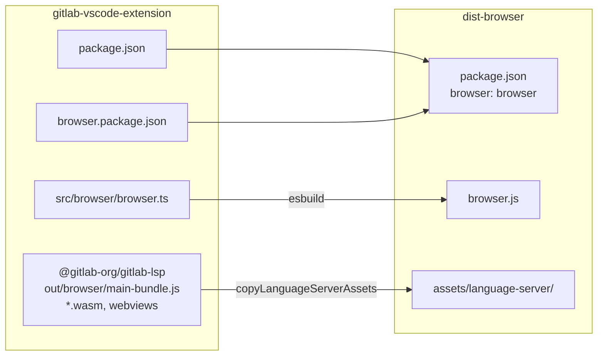
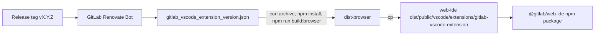
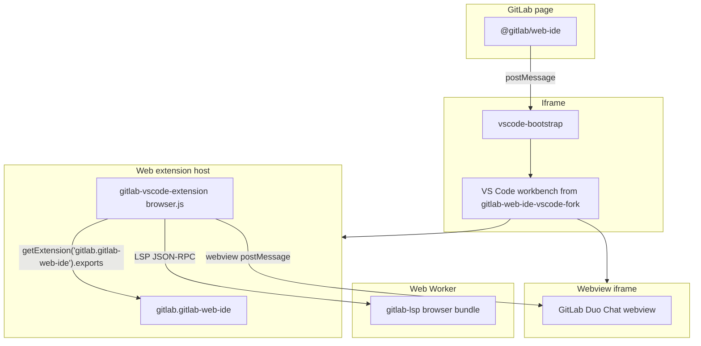
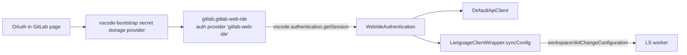

# Web IDE interoperability

As the [Architecture](architecture.md) document explains, this extension also runs in the browser,
inside the [GitLab Web IDE](https://gitlab.com/gitlab-org/gitlab-web-ide).

This document explains:

- How the Web IDE gets the extension, and which version it uses.
- How the browser build of the extension and of the GitLab Language Server (LS) is produced.
- How the extension runs in the Web IDE: activation, authentication, API access, and the LS.
- What you must keep in sync between this project and the Web IDE.

## Projects involved

| Project                                                                                  | Role in the Web IDE                                                                                                                                             |
| ---------------------------------------------------------------------------------------- | --------------------------------------------------------------------------------------------------------------------------------------------------------------- |
| [`gitlab-web-ide`](https://gitlab.com/gitlab-org/gitlab-web-ide)                         | Builds and publishes the `@gitlab/web-ide` npm package that the GitLab Rails app embeds. Bundles this extension as a built-in extension.                        |
| [`gitlab-web-ide-vscode-fork`](https://gitlab.com/gitlab-org/gitlab-web-ide-vscode-fork) | GitLab fork of VS Code. Provides the browser workbench. No other project in the chain is a fork.                                                                |
| `gitlab-vscode-extension` (this project)                                                 | Provides the browser build of the extension (`dist-browser`). The Web IDE builds it from a tagged source archive of this repository.                            |
| [`gitlab-lsp`](https://gitlab.com/gitlab-org/editor-extensions/gitlab-lsp)               | Provides the browser build of the LS (`out/browser/main-bundle.js`). Reaches the Web IDE only through this extension's `@gitlab-org/gitlab-lsp` npm dependency. |

The Web IDE does not use a fork of this extension or of the LS, and it does not install the
extension from a marketplace.

## Build and packaging

### Browser build in this project

`npm run build:browser` produces the `dist-browser` folder. It differs from the desktop build in three ways:

- **Manifest**: `createBrowserPackageJson()` in `scripts/utils/packages.mjs` merges `package.json`
  with `browser.package.json`. The result contains `"browser": "browser"` and no `main` entry,
  which makes VS Code load it as a web extension. It also contains
  `"extensionDependencies": ["gitlab.gitlab-web-ide"]`, so VS Code activates the Web IDE extension first.
- **Extension bundle**: `buildExtension()` in `scripts/utils/browser_jobs.mjs` bundles
  `src/browser/browser.ts` into `dist-browser/browser.js` with `esbuild --platform=browser`.
  The script passes the entry point as `src/browser/browser.js`, and `esbuild` resolves it to the
  `.ts` source file.
  It aliases `path` to `path-browserify` and marks Node.js built-ins (`fs`, `crypto`,
  `node:diagnostics_channel`, `graceful-fs`) as external. Values the extension imports from
  `@gitlab-org/gitlab-lsp` (for example, constants and `FixedTimeCircuitBreaker`) are bundled
  into `browser.js` from the LS `out/common/index.js` file.
- **Language Server assets**: `copyLanguageServerAssets()` in `scripts/utils/common_jobs.mjs`
  copies `node_modules/@gitlab-org/gitlab-lsp/out/browser/main-bundle.js`, the tree-sitter WASM
  files, and the LS webviews into `dist-browser/assets/language-server/`. The browser build never
  uses the Node.js LS bundle or the compiled `gitlab-lsp` binaries.



### Packaging in the Web IDE

The Web IDE package
[`packages/vscode-extension-gitlab-vscode-extension`](https://gitlab.com/gitlab-org/gitlab-web-ide/-/tree/main/packages/vscode-extension-gitlab-vscode-extension)
controls which version of this extension the Web IDE ships. Its `gitlab_vscode_extension_version.json`
file pins a release tag. For example:

```json
{
  "version": "6.65.1",
  "type": "url",
  "location": "https://gitlab.com/gitlab-org/gitlab-vscode-extension/-/archive/v6.65.1/gitlab-vscode-extension-v6.65.1.tar.gz"
}
```

The package `Makefile` supports two modes:

- `type: url` (default): downloads the source archive, runs `npm install && npm run build:browser`,
  and uses the resulting `dist-browser` folder.
- `type: path` (local development): copies an existing `dist-browser` folder. A
  `gitlab_vscode_extension_version.local.json` file selects this mode.

The Web IDE root `Makefile` then copies `dist-browser` to
`packages/web-ide/dist/public/vscode/extensions/gitlab-vscode-extension/`.
At startup, `vscode-bootstrap` fetches the extension `package.json` and registers the extension
as built-in through the `gitlab-builtin-vscode-extensions` meta tag. The workbench reads the
`browser` entry and loads `browser.js` in the web extension host.

GitLab Renovate Bot opens Web IDE merge requests that update the pinned tag after a release of this
extension. The Web IDE does not follow `main` of this project.



### Published artifacts

This project publishes only the desktop VSIX (`dist-desktop/*.vsix`, `main: extension`, no `browser`
entry) to the Visual Studio Marketplace, Open VSX, and the GitLab package registry.
The browser build is never published. Because the VSIX has no `browser` entry, it can't run in a
web extension host, so the Web IDE must build `dist-browser` from source.

The Web IDE can enable an extension marketplace for third-party extensions. The built-in GitLab
extension does not come from it.

## Versions

| Version         | Source                                                                             | Where it's reported                                                                                                                                                            |
| --------------- | ---------------------------------------------------------------------------------- | ------------------------------------------------------------------------------------------------------------------------------------------------------------------------------ |
| Extension       | `version` in `package.json` at the pinned tag                                      | `context.extension.packageJSON.version`, shown in the extension diagnostics. Sent to the LS in `initializationOptions` by `src/browser/language_server/get_client_context.ts`. |
| Language Server | `@gitlab-org/gitlab-lsp` version resolved in `package-lock.json` at the pinned tag | Returned by the LS in `serverInfo.version` of the `initialize` result. `LanguageServerManager.version` reads it.                                                               |

The Web IDE does not pin a Language Server version. To ship a new LS version to the Web IDE,
update `@gitlab-org/gitlab-lsp` in this project, release the extension, and update the pinned tag
in the Web IDE.

## Runtime

### Environments

The Web IDE runs in four environments:

- **Main**: the GitLab page that imports `@gitlab/web-ide`.
- **Iframe**: loads `vscode-bootstrap` and the VS Code workbench from the VS Code fork.
- **Extension host**: runs the Web IDE extension (`gitlab.gitlab-web-ide`) and this extension.
  This extension starts the LS in a dedicated Web Worker.
- **Webview**: each extension webview, like GitLab Duo Chat, runs in its own iframe, isolated
  from the `vscode-bootstrap` iframe. `vscode-bootstrap` sets `webviewContentExternalBaseUrlTemplate`
  so webview content loads from `extensionsHostBaseUrl`. Webviews communicate with this extension
  only through the VS Code webview message API.



### Activation

`activate()` in `src/browser/browser.ts`:

1. Reads the exports of the Web IDE extension (`WebIDEExtension`: `gitlabUrl`, `projectPath`,
   `currentRef`, and `isTelemetryEnabled()`). Throws if the exports are missing.
1. Creates the browser dependency container (`src/browser/dependency_container_browser.ts`).
1. Starts the LS with `browserLanguageClientFactory`.
1. Runs the shared `activateCommon()`.

### Authentication and API access

The Web IDE owns the OAuth token. The extension reads it through the VS Code authentication API:



- `getWebIdeAuthSession()` in `src/browser/auth/web_ide_authentication.ts` calls
  `vscode.authentication.getSession('gitlab-web-ide', ['api'], { silent: true })`.
  The Web IDE lists `gitlab.gitlab-workflow` in the workbench `trustedExtensionAuthAccess`
  product configuration, so this call does not show a consent prompt.
- When the token refreshes, the Web IDE updates its auth provider. `WebIdeAuthentication` listens to
  `onDidChangeSessions`, refreshes the session, and fires `onChange`. The LS client wrapper then
  sends the new token to the LS.
- `createApiClient()` in `src/browser/api/factory.ts` returns a `DefaultApiClient` that sends
  `Authorization: Bearer <token>` directly to the GitLab API. If no session token is available,
  it falls back to the deprecated `MediatorCommandsApiClient`, which runs API requests through
  Web IDE mediator commands.

### Language Server in the Web IDE

The LS always starts in the Web IDE. There is no feature flag. The extension side works like this:

- `src/browser/language_server/browser_language_client_factory.ts` creates a `Worker` from
  `assets/language-server/browser/main-bundle.js` and passes it to the
  `vscode-languageclient/browser` `LanguageClient`.
- The client `documentSelector` in `src/common/language_server/language_server_manager.ts`
  includes the `gitlab-web-ide` scheme, which the Web IDE file system uses.
- `LanguageServerManager` sends `baseAssetsUrl` (`<extensionUri>/assets/language-server/`) in
  `initializationOptions`.
- `browser.ts` calls `setCustomPlatformConfig({ webIdeCurrentRef, webIdeProjectPath })`, and
  `LanguageClientWrapper.syncConfig()` adds these values to every `workspace/didChangeConfiguration`
  notification.

The browser LS can't use a file system, a local Git repository, or a local HTTP server. LS-hosted
webviews don't run in the Web IDE, so GitLab Duo Chat there uses the extension `gitlab_duo_chat`
webview and `AIContextManagerWebIde`, a stub that doesn't use the LS.

For the LS side, including what the browser LS does with these values and which features it
doesn't support, see the LS
[Browser build and the Web IDE](https://gitlab.com/gitlab-org/editor-extensions/gitlab-lsp/-/blob/main/docs/developer/browser.md)
documentation.

## Shared contract with the Web IDE

`src/common/platform/web_ide.ts` in this project and
[`packages/web-ide-interop/src/index.ts`](https://gitlab.com/gitlab-org/gitlab-web-ide/-/blob/main/packages/web-ide-interop/src/index.ts)
in the Web IDE are hand-maintained copies of the same contract. They define:

- `WEB_IDE_EXTENSION_ID`, `WEB_IDE_AUTH_PROVIDER_ID`, and `WEB_IDE_AUTH_SCOPE`.
- The `WebIDEExtension` interface that the Web IDE extension returns from `activate()`.
- The mediator command IDs and API request types.

No tooling checks that the copies match. When you change the contract, update both files in
coordinated merge requests.

The extension ID `gitlab.gitlab-workflow` is also part of the contract: the Web IDE lists it in
`trustedExtensionAuthAccess`. Renaming the extension breaks silent authentication in the Web IDE.

## Test your changes in the Web IDE

If you change code in `src/browser` or `src/common`, test it in the Web IDE:

- To run the Web IDE with your local build, follow the Web IDE
  [GitLab for VS Code extension](https://gitlab.com/gitlab-org/gitlab-web-ide/-/blob/main/docs/development/gitlab-for-vscode-extension.md)
  documentation. In this project, `npm run watch:browser -- --webIde <path>` copies every
  rebuild into the Web IDE package `dist` folder. Without `--webIde`, it expects the
  `gitlab-web-ide` project next to this one.
- To test Language Server changes in the Web IDE, link your local LS into this project first, as
  described in [Language server development and debugging](language-server.md). Then rebuild the browser
  build of the extension.
- The `test-integration-web` CI job builds `dist-browser`, clones `gitlab-web-ide` from `main`,
  and runs the Web IDE Code Suggestions Playwright test against your branch. The job is allowed
  to fail, so check its result on merge requests that change browser code.
